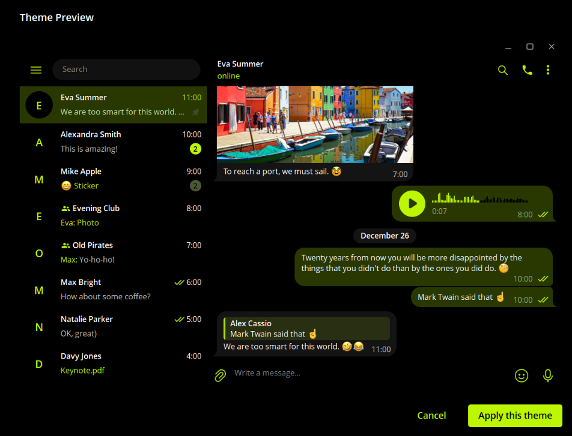
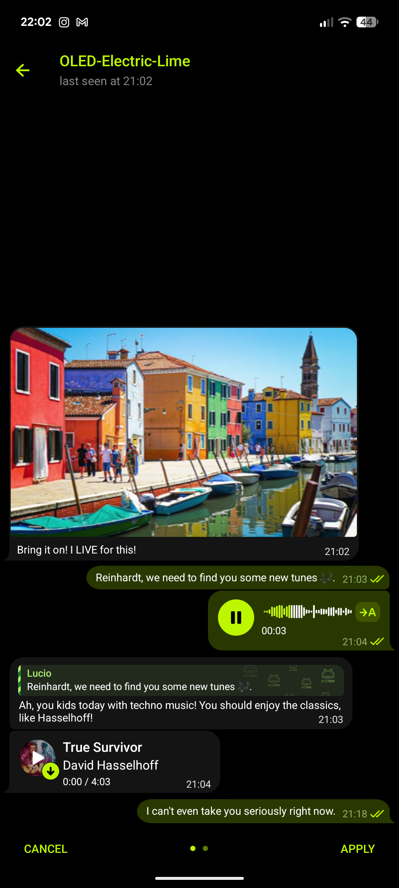
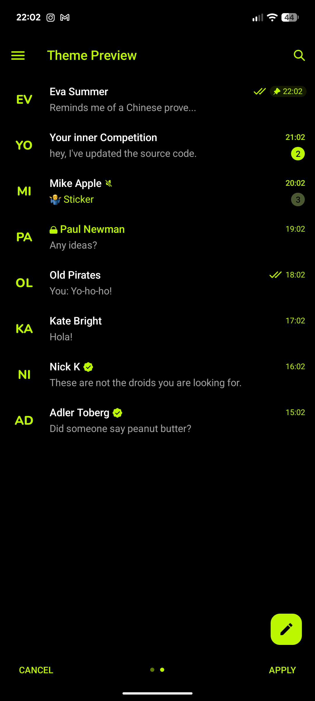
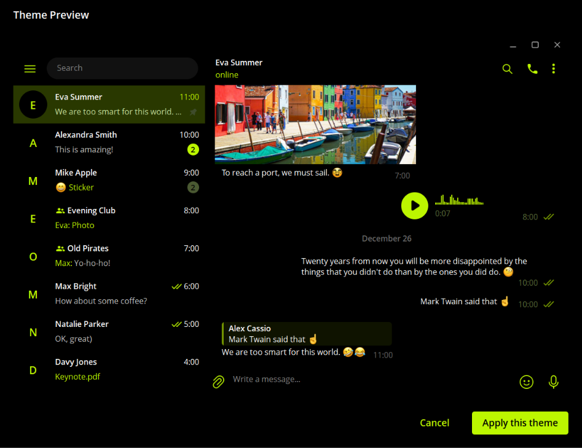

# OLED Electric Lime — Telegram Themes ⚡️🟢

A collection of ultra-minimalist, high-contrast dark themes for Telegram across Desktop, Android, and iOS.

* **True OLED Black (`#000000`)**: Designed to completely turn off pixels on OLED/AMOLED displays, saving battery and eliminating eye strain.
* **Electric Lime (`#bcf600`)**: A vibrant, sharp accent color used consistently across the entire UI for crisp contrast and instant readability.
* **Flat & Clean**: Zero unnecessary gradients, zero intrusive shadows, and no visual clutter.

---

## 📸 Preview & Screenshots

### 1. OLED Electric Lime (Classic)
*Dark olive outgoing bubbles (`#293800`), subtle dark gray incoming bubbles, sharp lime accents.*

#### 💻 Desktop Preview

#### 📱 Mobile Preview (Chat & Overview)

  
  

---

### 2. OLED Electric Lime (Pure Black)
*Bubble-less pure black void (`#000000`) with clean floating white text and subtle lime highlights.*

#### 💻 Desktop Preview

#### 📱 Mobile Preview (Chat & Overview)

  
  

---

## ⚡️ Quick Install (Cloud Links)

* **OLED Electric Lime (Classic)**: [t.me/addtheme/OLED_Electric_Lime](https://t.me/addtheme/OLED_Electric_Lime)  
* **OLED Electric Lime (Pure Black)**: [t.me/addtheme/OLED_Electric_Lime_Pure](https://t.me/addtheme/OLED_Electric_Lime_Pure)  

---

## 📥 Manual Installation (Files)

### 1. Classic Theme (`OLED-Electric-Lime`)
* **Desktop (Windows / macOS / Linux)**: [`OLED-Electric-Lime.tdesktop-theme`](OLED-Electric-Lime/Telegram-Desktop/OLED-Electric-Lime.tdesktop-theme)
* **Android**: [`OLED-Electric-Lime.attheme`](OLED-Electric-Lime/Android/OLED-Electric-Lime.attheme)
* **iOS**: [`OLED-Electric-Lime.tgtheme`](OLED-Electric-Lime/iOS/OLED-Electric-Lime.tgtheme)

### 2. Pure Black Theme (`OLED-Electric-Lime-Pure-Black`)
* **Desktop (Windows / macOS / Linux)**: [`OLED-Electric-Lime-Pure-Black.tdesktop-theme`](OLED-Electric-Lime-Pure-Black/Telegram-Desktop/OLED-Electric-Lime-Pure-Black.tdesktop-theme)
* **Android**: [`OLED-Electric-Lime-Pure-Black.attheme`](OLED-Electric-Lime-Pure-Black/Android/OLED-Electric-Lime-Pure-Black.attheme)
* **iOS**: [`OLED-Electric-Lime-Pure-Black.tgtheme`](OLED-Electric-Lime-Pure-Black/iOS/OLED-Electric-Lime-Pure-Black.tgtheme)

> **💡 How to apply manually:** Send the corresponding theme file to your **Saved Messages** in Telegram, click/tap on the file, and choose **Apply Theme**.
